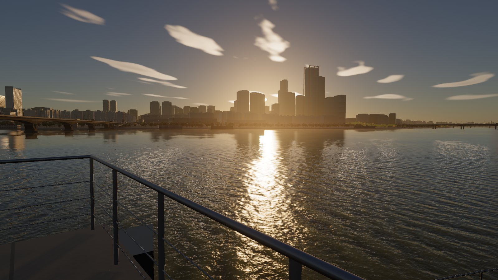
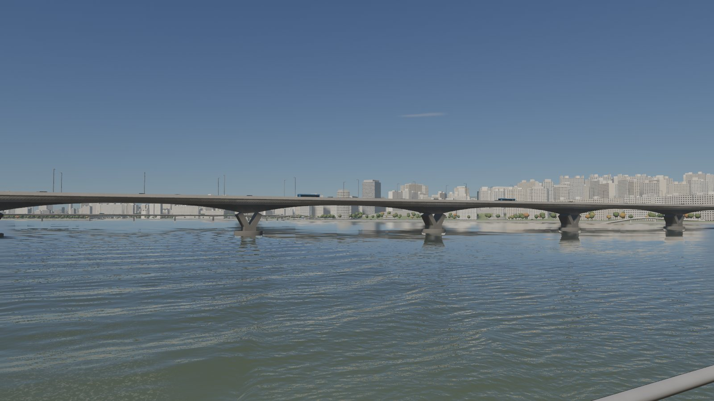
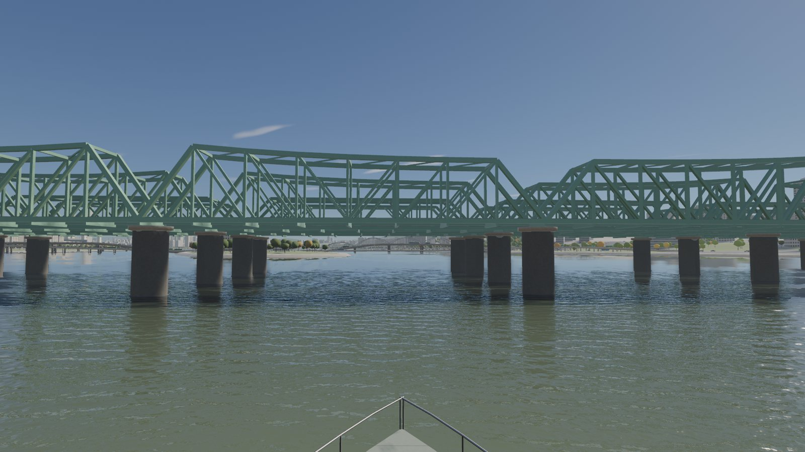
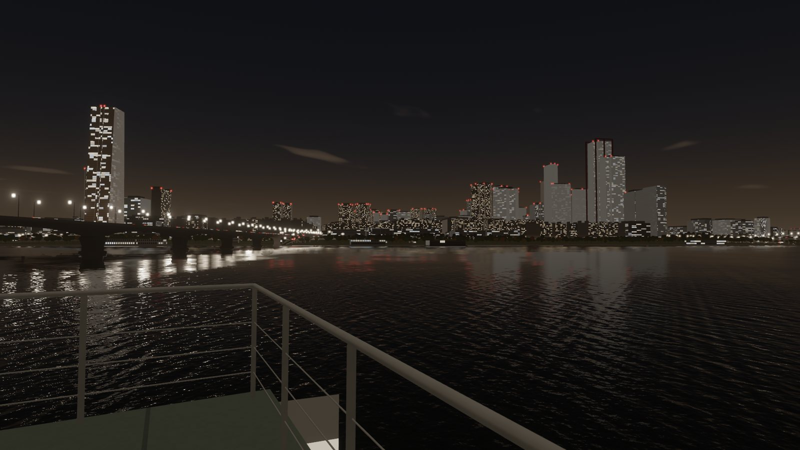
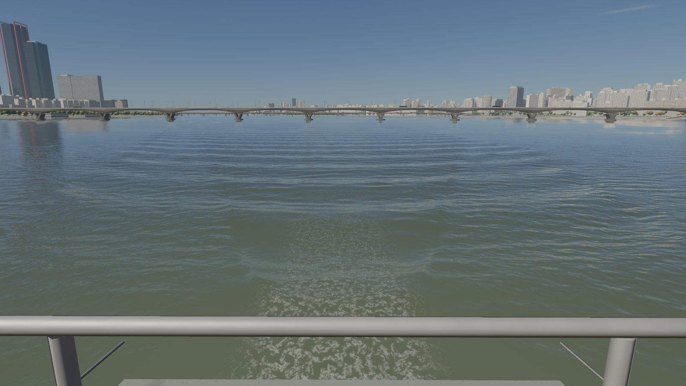

# 한강 유람선 (han-cruise)

서울 한강 유람선의 야외 갑판에 서서 여의도 → 원효대교 → 한강철교 → 노들섬 앞 회항 → 여의도 구간을 관람하는 실시간 3D 웹 앱입니다. WebGPU로 렌더링하며, 실제 지리 자료(OpenStreetMap, 고도 타일)를 바탕으로 강·강변·교량·건물을 배치했습니다.



| 원효대교 측면 (낮) | 한강철교 접근 (낮) |
|---|---|
|  |  |
| **야간, 여의도 스카이라인과 수면 반사** | **선미 항적 (켈빈 파 + 짧은 거품)** |
|  |  |

> 이 항로는 실제 지형·교량 위치를 바탕으로 이 앱을 위해 만든 **시연 항로**입니다. 특정 운항사의 실제 상품·일정이 아닙니다.

## 실행

요구 사항: Node.js 20+, WebGPU를 지원하는 데스크톱 브라우저(검증: Chrome 155 / macOS).

```bash
npm install
npm run dev            # http://127.0.0.1:5173/
# 배포용
npm run build && npm run preview   # http://127.0.0.1:4173/
```

씬 데이터(`public/data/`)는 저장소에 포함되어 있어 바로 실행됩니다. 원본에서 다시 만들려면:

```bash
npm run fetch-data     # OSM(Overpass) + 고도 타일 다운로드 → data-raw/ (curl 필요)
npm run build-scene    # 가공 → public/data/
node tools/check-route.mjs   # 항로 검증 (수심 여유, 교각 사이 통과, 교량 하부 여유고)
```

### 조작

| 입력 | 동작 |
|---|---|
| 드래그(마우스·터치) / 방향키 | 갑판에서 둘러보기 |
| 휠 | 확대·축소 |
| `Space` / ▶❚❚ 버튼 | 항해 일시정지·재개 |
| `1`–`5` / 시점 버튼 | 선수 · 좌현 · 우현 · 선미 · 하갑판 |
| `T` / 시간대 버튼 | 낮 · 골든아워 · 야간 |
| `M` / 소리 버튼 | 소리 켜기·끄기 |
| `I` / 해설 버튼 | 랜드마크 해설 표시 |
| 설정 | 화질(자동/높음/보통/낮음), 모션 줄이기 |

개발·감상용 보조 기능은 `?dev` 주소에서만 켜집니다(`F` 자유 비행 카메라, `` ` `` 성능 표시). 검증 장면은 `?scene=<이름>`으로 고정 재현됩니다(`src/sim/scenes.js`).

## 기술 구성과 선택 이유

**엔진 없이 WebGPU 직접 사용**을 유지하되, 참고 프로젝트를 도시·교량·선박을 담는 렌더러로 확장했습니다.

- 사실감의 핵심인 수면(FFT 파도, LEAN 거칠기, 정확한 태양 반짝임)과 물리 대기(Hillaire LUT)가 [web-ocean](https://github.com/Noniv/web-ocean)에 이미 WGSL로 구현되어 있어, 이를 그대로 기반으로 삼는 것이 품질 면에서 가장 유리했습니다. three.js 같은 엔진으로 옮기면 이 셰이더를 엔진의 조명·후처리 체계에 다시 맞춰야 하고, 수면과 도시가 서로 다른 조명 모델을 쓰게 될 위험이 있습니다.
- 대신 모든 불투명 물체(지형, 건물, 교량, 선박, 수목, 차량)가 **하나의 조명 모듈**(`src/wgsl/lighting.js`: 태양·하늘·도시 불빛, 3단 캐스케이드 그림자, 교량 하부 차폐, 대기 원근)을 공유해, 수면과 같은 환경에 속해 보이게 했습니다.
- 지오메트리는 데이터 기반 절차 생성입니다. 빌드 단계(Node)가 OSM·DEM을 강 거리장(SDF)·지형 높이·건물 외곽선·교량 축/교각/종단면으로 가공하고, 브라우저(웹 워커)가 이를 메쉬로 만듭니다. 외부 3D 모델은 쓰지 않아 라이선스와 로딩 크기(약 12 MB)를 통제했습니다.
- 빌드: Vite(정적 배포), 의존성 earcut(지붕 삼각분할)뿐입니다.

| 영역 | 구현 |
|---|---|
| 수면 | 4단 FFT(41 m–0.53 m, 256²), 강 바람(취송거리 2.5 km) 스펙트럼, 하류 방향 표층 유속 이동, 혼탁한 한강 물색, 평면 반사(반해상도, 깊이 기반 재투영 → 불빛의 세로 줄무늬), 기슭의 얕은 물, 교량 그림자·하부 차폐 |
| 항적 | 항로 좌표(호 길이·횡거리)에서 **켈빈 항적을 정류위상으로 해석 계산**(횡파·발산파·19.47° 경계), 선수·선미 간섭, 통과 후 시간에 따른 감쇠, 선미 와류 거품(수 초 내 분해)과 오래 남는 잔잔한 띠. 항로가 휘면 항적도 함께 휨 |
| 하늘 | 물리 대기 LUT, 실제 날짜·시각의 태양·달 위치(2026-10-18, 서울), 고층운, 야간 도시 하늘빛, 반해상도 렌더 |
| 도시 | OSM 건물 31,574동(높이 태그 23,857동, 나머지는 외곽선 기반 추정), 층·창 격자 파사드(원거리 필터링), 창 깊이에 따른 햇빛 그림자, 아파트 남측 발코니 면(세대 벽·난간 띠·창틀), 판상 아파트 측벽의 동 번호("101동"), 커튼월 패널별 반사 흔들림, 옥상 구조물, 야간 창문 점등, 63빌딩(금색 반사유리·테이퍼), 파크원(붉은 프레임), IFC(경사 유리 정수리, 형태는 사진 기반 근사), N서울타워, 강변 고가도로, 차량 |
| 교량 | 원효대교(헌치 박스거더 + 원형 케이슨 위 Y형 교각), 한강철교 A·B(워런 트러스)·C·D(연속 트러스, 녹색 도장, 원형 교각), 한강대교(노들섬–노량진 구간 아치), 마포·서강·동작·양화·당산철교 |
| 선박 | 약 50 m 2층 유람선(선체 단면, 객실 창, 갑판 난간·벤치·구명환, 항해등), 미세한 롤·피치, 선회 시 바깥 기울기, 접안 감속 |
| 후처리 | 블룸(태양 입력 제한), 자동 노출(시간대별 목표), AgX 톤매핑, 디더링 |
| 사운드 | Web Audio 합성(엔진·선체 물소리·바람·도시 원경음, 교량 아래 잔향). 녹음 자산 없음 |

## 성능 (실측)

검증 환경: **MacBook Air 13" (Mac16,12), Apple M4 10코어 GPU, 팬 없음**, macOS, Chrome 155, 1920×1080.

- 실사용 조건(1920×1080 창, 자동 화질, vsync): **3분간 60.1 fps, 17.5 ms 초과 프레임 0건**, 렌더 해상도 1920×1080 유지, GPU 11–14 ms (`tools/sustain.mjs`)
- 장면별 처리량(vsync 해제, 냉각 상태): 프레임 8–10 ms. 같은 조건을 계속 돌리면 열 스로틀링으로 약 1분 뒤 14–16 ms까지 늘어남 (`tools/perf-scenes.mjs`)
- 첫 로딩(로컬 서버, 캐시 없음): 시작 버튼 활성화까지 0.9–1.0 s(데이터 ~80 ms, 메쉬 ~200 ms, GPU 파이프라인 ~450 ms). 실제 네트워크에서는 데이터 약 12 MB 다운로드가 추가됩니다.
- GPU 시간이 14.5 ms를 넘으면 '자동' 화질이 렌더 해상도를 낮춥니다(최저 60%).

다른 GPU·브라우저에서는 측정하지 않았습니다. 자세한 수치와 방법은 [docs/VERIFICATION.md](docs/VERIFICATION.md).

## 검증

[docs/VERIFICATION.md](docs/VERIFICATION.md)에 지리·항로 검증, 고정 장면 캡처, 실제 사진 비교, 연속 이동 영상 검토, UI·오류 상태 점검(17/17 통과), 성능 측정, 미검증 항목을 정리했습니다.

## 자산 출처·라이선스

- 이 저장소 자체 코드의 라이선스는 아직 정하지 않았습니다(저장소 소유자 결정 필요). 수면·대기·후처리 셰이더 일부는 web-ocean(MIT, © 2026 Maksymilian Dendura)에서 가져와 수정 — `licenses/web-ocean-LICENSE.txt`
- 지도 데이터: © OpenStreetMap 기여자, ODbL 1.0
- 고도: AWS Terrain Tiles(terrarium; 한국 지역은 SRTM 등)
- 텍스처·소리: 모두 셰이더/코드로 절차 생성(외부 파일 없음)

상세: [THIRD_PARTY_NOTICES.md](THIRD_PARTY_NOTICES.md)

## 남은 제약과 다음 개선 우선순위

1. **건물 디테일**: 아파트 발코니 면, 동 번호, 창 깊이 그림자, IFC 정수리는 반영했습니다. 발코니·창 깊이는 셰이더로 표현해 실제 돌출 지오메트리가 없고, 동 번호는 실제 번호가 아닌 임의값입니다. 간판, 63빌딩 상부, 용산 고층 단지 형태는 아직 단순합니다. 높이 태그가 없는 7,717동은 추정 높이입니다.
2. **구름**: 2D 층 구름이라 형태가 단순해 기본값에서 저층운을 껐습니다. 체적 구름 또는 사진 기반 하늘 돔 검토.
3. **교량 제원 추정치**: 원효대교 경간(≈100 m), 한강철교 레일 높이(수면 위 ≈11 m), 교량 상판 높이는 확인 가능한 자료가 없어 추정했습니다(원효대교 하부 14.0 m, 한강철교 하부 10.5 m). 정확한 도면 자료로 교체 필요.
4. **강변**: 호안·산책로·공원이 거리장 프로파일로 일반화되어 있습니다. 실제 계단식 호안, 수상 시설, 노들섬 건축물, 한강대교 조명 등은 미구현.
5. **야간**: 교량 경관조명, 차량 불빛 밀도, 도시 하늘빛 색을 실제 야경 사진과 더 맞춰야 합니다.
6. **검증 범위**: Safari·Firefox, Windows/외장 GPU, 실제 터치 기기, 스크린리더, 사운드 청감은 검증하지 못했습니다.
